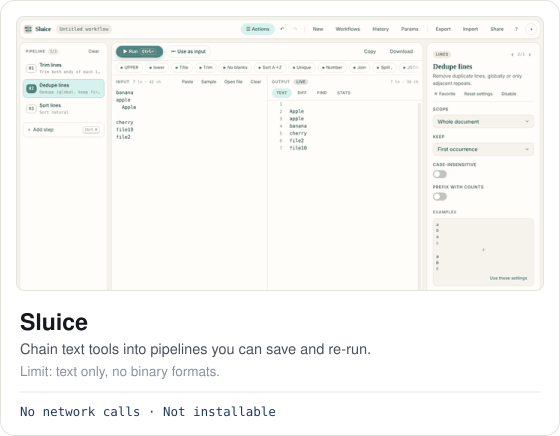
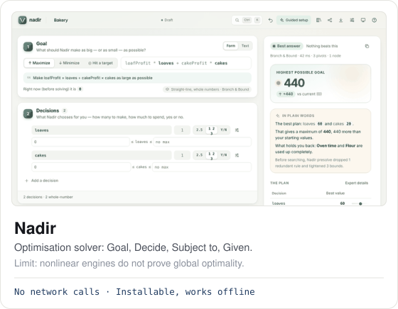
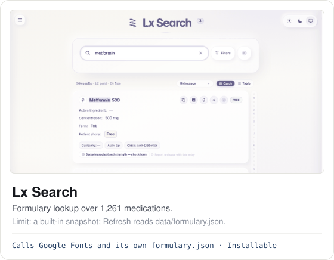

<picture>
<source media="(prefers-color-scheme: dark)" srcset="assets/banner-dark.svg">

</picture>

<table>
<tr>
<td width="50%" valign="top">
<a href="https://power-query-manager.vercel.app"><picture><source media="(prefers-color-scheme: dark)" srcset="assets/quoin-dark.svg"></picture></a> 
<a href="https://github.com/datakid/power-query-manager">Repository</a> · <a href="https://power-query-manager.vercel.app">Live</a>
</td>
<td width="50%" valign="top">
<a href="https://duckbench2.vercel.app"><picture><source media="(prefers-color-scheme: dark)" srcset="assets/duckbench-dark.svg"></picture></a> 
<a href="https://github.com/datakid/duckbench">Repository</a> · <a href="https://duckbench2.vercel.app">Live</a>
</td>
</tr>
<tr>
<td width="50%" valign="top">
<a href="https://data-cleaner-coral.vercel.app"><picture><source media="(prefers-color-scheme: dark)" srcset="assets/weft-dark.svg"></picture></a> 
<a href="https://github.com/datakid/data-cleaner">Repository</a> · <a href="https://data-cleaner-coral.vercel.app">Live</a>
</td>
<td width="50%" valign="top">
<a href="https://text-tools-kohl.vercel.app"><picture><source media="(prefers-color-scheme: dark)" srcset="assets/sluice-dark.svg"></picture></a> 
<a href="https://github.com/datakid/text-tools">Repository</a> · <a href="https://text-tools-kohl.vercel.app">Live</a>
</td>
</tr>
<tr>
<td width="50%" valign="top">
<a href="https://solver-clone.vercel.app"><picture><source media="(prefers-color-scheme: dark)" srcset="assets/nadir-dark.svg"></picture></a> 
<a href="https://github.com/datakid/solver-clone">Repository</a> · <a href="https://solver-clone.vercel.app">Live</a>
</td>
<td width="50%" valign="top">
<a href="https://lx-search-kappa.vercel.app"><picture><source media="(prefers-color-scheme: dark)" srcset="assets/lx-search-dark.svg"></picture></a> 
<a href="https://github.com/datakid/lx-search-">Repository</a> · <a href="https://lx-search-kappa.vercel.app">Live</a>
</td>
</tr>
</table>

**Files and data**  
[Veritas Lens](https://github.com/datakid/pattern-recognition-) · [Alembic](https://github.com/datakid/dashboard2) · [bugvert](https://github.com/datakid/bugvert) · [draw](https://github.com/datakid/draw) · [lx-id](https://github.com/datakid/lx-id) · [gitlink](https://github.com/datakid/gitlink) · [harvest-studio](https://github.com/datakid/harvest-studio)

**Formulary and search**  
[newlist](https://github.com/datakid/newlist) · [searchbar](https://github.com/datakid/searchbar) · [lx-parser](https://github.com/datakid/lx-parser)

**Reporting forms (Arabic)**  
[slippery-form-2.2](https://github.com/datakid/slippery-form-2.2) · [daftar](https://github.com/datakid/daftar) · [finalapp](https://github.com/datakid/finalapp)

**Launchers and workspace**  
[app-launcher](https://github.com/datakid/app-launcher) · [alt-app-lanucher](https://github.com/datakid/alt-app-lanucher) · [Desktop](https://github.com/datakid/Desktop)

**Desktop and Android**  
[ps-tools-](https://github.com/datakid/ps-tools-) · [duckbench-tauri-demo](https://github.com/datakid/duckbench-tauri-demo) · [tacit](https://github.com/datakid/tacit) · [contact-flow](https://github.com/datakid/contact-flow)

**Other**  
[survival-mirror](https://github.com/datakid/survival-mirror) · [Pillbug](https://github.com/datakid/Pillbug) · [shareholders](https://github.com/datakid/shareholders)

**Archived or superseded**  
[dashboard-yearly](https://github.com/datakid/dashboard-yearly) · [experimental](https://github.com/datakid/experimental)

Network and limits, tool by tool

### Selected tools

| Tool | What it does, and what it does not | Network / install |
| --- | --- | --- |
| [Quoin](https://github.com/datakid/power-query-manager) · [live](https://power-query-manager.vercel.app) | Opens an `.xlsx` or `.xlsm` in the browser and edits and runs the Power Query (M) and VBA inside it. VBA is edited but never run, and the library functions the interpreter does not support stop with an error that names the function. | No network calls. Files stay in the tab; Installable (PWA); works offline after the first load. |
| [Duckbench](https://github.com/datakid/duckbench) · [live](https://duckbench2.vercel.app) | Data prep over CSV, Excel, JSON and Parquet with visual steps or DuckDB SQL. CSV streams into memory up to about 1 GB; larger files are queried in place, and steps that cannot be translated to SQL then run on the first 1,000,000 rows. | Calls jsDelivr for DuckDB-WASM and hyparquet, and extensions.duckdb.org for the Excel extension; nothing else leaves the browser. Not installable; no service worker. |
| [Weft](https://github.com/datakid/data-cleaner) · [live](https://data-cleaner-coral.vercel.app) | Turns pasted text or a file into a table. Every change is an undoable step. When the first guess at the format is wrong, it offers other readings to switch to. | No network calls. Files stay in the tab. Not installable; no service worker. |
| [Sluice](https://github.com/datakid/text-tools) · [live](https://text-tools-kohl.vercel.app) | Chains text operations into pipelines that can be saved and re-run. It reads and writes text only; there is no binary format support. | No network calls. Files stay in the tab. Not installable; no service worker. |
| [Lx Search](https://github.com/datakid/lx-search-) · [live](https://lx-search-kappa.vercel.app) | Formulary lookup over 1,261 medications: coverage, price, prescribing authority. The data is a snapshot built into the app; Refresh loads `data/formulary.json` from the same site. | Calls Google Fonts and, on Refresh, its own `formulary.json`; nothing else leaves the browser. Installable (PWA); works offline after the first load. |
| [Nadir](https://github.com/datakid/solver-clone) · [live](https://solver-clone.vercel.app) | Optimisation solver in vanilla JavaScript: Goal, Decide, Subject to, Given. Linear and integer models use simplex and branch and bound; nonlinear models use ALM with L-BFGS or Differential Evolution, which do not prove global optimality. | No network calls. Files stay in the tab; Installable (PWA); works offline after the first load. |
| [Veritas Lens](https://github.com/datakid/pattern-recognition-) · [live](https://pattern-recognition-sooty.vercel.app) | On-device file forensics, including C2PA manifests. Only objective signals change the score. There is no trained classifier, so many generated images without tags report Inconclusive. | No network calls after load; loads Google Fonts from a CDN. Not installable; no service worker. |
| [Alembic](https://github.com/datakid/dashboard2) · [live](https://dashboard2-iota.vercel.app) | Pharmacy dashboard with overview, charts and compare tabs. It reads one fixed Google Sheet as CSV and has no file upload. | Calls Google Sheets for its data; loads Chart.js, Fuse.js, PapaParse and Google Fonts from CDNs. Not installable; no service worker. |

### Formulary and search

- [newlist](https://github.com/datakid/newlist) — LX Search 5.5. Medicine search with a calculator for several pricing models. The tray holds at most 30 calculations. Calls Google Fonts and, on Refresh, its own `data/drugs.json`; nothing else leaves the browser. Not installable; no service worker.
- [searchbar](https://github.com/datakid/searchbar) — Lx Search F4. Lookup over 1,106 medication records in one file with no build step. Two Acetyl Salicylic Acid variants still match weakly when spelled phonetically. Loads Google Fonts from a CDN. Not installable; no service worker.
- [lx-parser](https://github.com/datakid/lx-parser) — Reads messy Arabic and English inventory sheets and detects headers and layout. All data stays in this browser, with no server and no sync. Calls Google Sheets for remote sources; loads PapaParse and Google Fonts from CDNs.

### Reporting forms (Arabic)

- [slippery-form-2.2](https://github.com/datakid/slippery-form-2.2) — Tally. External-tickets report tool for casual users and fast typists. No cloud sync or multi-device sharing. No network calls. Installable (PWA); works offline after the first load.
- [daftar](https://github.com/datakid/daftar) — Ledger reports from dispensing sheets in Excel or CSV; prints onto A4 forms. Inline cell editing is not built. No network calls. Files stay in the tab. Not installable; no service worker.
- [finalapp](https://github.com/datakid/finalapp) — Monthly drug-group totals by category, with bulk file upload. Submission uses `no-cors`, so the server never confirms receipt. Calls a Cloudflare Worker to submit totals; loads Google Fonts from a CDN.

### Launchers and workspace

- [app-launcher](https://github.com/datakid/app-launcher) — LinkExpress. Bilingual launchpad driven by `links.json`. Icons that are not bundled are fetched from jsDelivr, with a fallback icon when the name does not exist. Calls jsDelivr for icons; nothing else leaves the browser. Installable (PWA); works offline after the first load.
- [alt-app-lanucher](https://github.com/datakid/alt-app-lanucher) — Fihrist. Keyboard-first index of the tools above. It lists only the tools in `fihrist.json`. No network calls after load; loads Google Fonts from a CDN. Installable (PWA); works offline after the first load.
- [Desktop](https://github.com/datakid/Desktop) — Lx Workspace. Window manager with snapping and tabs, command palette and dock in the browser. The tool list is fixed in `index.html`. Calls each tool's own site when its window opens; nothing else leaves the browser. Installable (PWA); works offline after the first load.

### Utilities

- [bugvert](https://github.com/datakid/bugvert) — Unit and price converter for messy pharmacy and inventory sheets. Choosing which sheets to merge is not implemented. No network calls after load; loads Google Fonts from a CDN. Not installable; no service worker.
- [draw](https://github.com/datakid/draw) — Drop a CSV, XLSX, Parquet or JSON file and get a chart. Column names cannot contain `[` or `]`. No network calls after load; loads ECharts, PapaParse and, for Parquet files, hyparquet from a CDN. Not installable; no service worker.
- [gitlink](https://github.com/datakid/gitlink) — Maps a GitHub account's follow graph: mutuals, followers, following, fans. Hidden or suspended accounts can leave lists shorter than the profile counts. Calls the GitHub REST API (60 requests an hour, 5,000 with a token) and GraphQL when a token is set; nothing else leaves the browser.
- [harvest-studio](https://github.com/datakid/harvest-studio) — Harvests favicons, traces glyphs and exports icon sets for LinkExpress. Pages that answer 401, 403 or 429, or show a challenge, are reported as blocked and not converted. Fetches favicons from third-party sites through a proxy you deploy; the command line fetches them directly.
- [lx-id](https://github.com/datakid/lx-id) — Egyptian national ID, retirement and date toolkit. The check digit's algorithm is not public, so the checksum shown is a heuristic. No network calls after load; loads SheetJS and Google Fonts from CDNs. Installable (PWA); works offline after the first load.
- [survival-mirror](https://github.com/datakid/survival-mirror) — Population survival curves from age, sex, country and lifestyle answers. Death rates are held at today's values. No network calls. Not installable; no service worker.
- [Pillbug](https://github.com/datakid/Pillbug) — Pharmacy inventory demo with no framework and no backend. Data lives in `localStorage` in one browser. No network calls after load; loads Google Fonts from a CDN. Not installable; no service worker.
- [shareholders](https://github.com/datakid/shareholders) — Qisma. Fair distribution of incentive pools to the piastre, in Arabic. Review rows are built eagerly, so the first render at 1M+ rows allocates a row object per row. No network calls after load; loads Google Fonts from a CDN. Installable (PWA); works offline after the first load.

### Desktop and Android

- [ps-tools-](https://github.com/datakid/ps-tools-) — Windows right-click toolkit. One exe, no installer. Windows only; administrator actions show their script first and need UAC. Desktop build (Windows); binary in Releases. The download-link action calls the address you copy.
- [duckbench-tauri-demo](https://github.com/datakid/duckbench-tauri-demo) — Duckbench for Windows on Tauri 2 and DuckDB. Windows only; `release.yml` does not sign or publish `latest.json` yet. Desktop build (Tauri); binary in Releases.
- [tacit](https://github.com/datakid/tacit) — Keyboard-first Android launcher with Arabic-aware search. Nothing has been measured on a real phone. No INTERNET permission. Android (Kotlin); source only, no published APK.
- [contact-flow](https://github.com/datakid/contact-flow) — Contact import and export, with search in Arabic, English and Chinese. `.numbers` is exported as a spreadsheet that Numbers opens, because Apple's native format is undocumented. No network permission. Android (Flutter); APKs in Releases.

### Archived or superseded

- [dashboard-yearly](https://github.com/datakid/dashboard-yearly) — Superseded by Alembic.
- [experimental](https://github.com/datakid/experimental) — Drug protocol index. The page states its content is AI-generated and not for actual use.

Forks on this account (tacit, roi-calculator, entity-tracker, To-Do) are from my own alternate account, not third-party code. winget-pkgs is an upstream fork.
