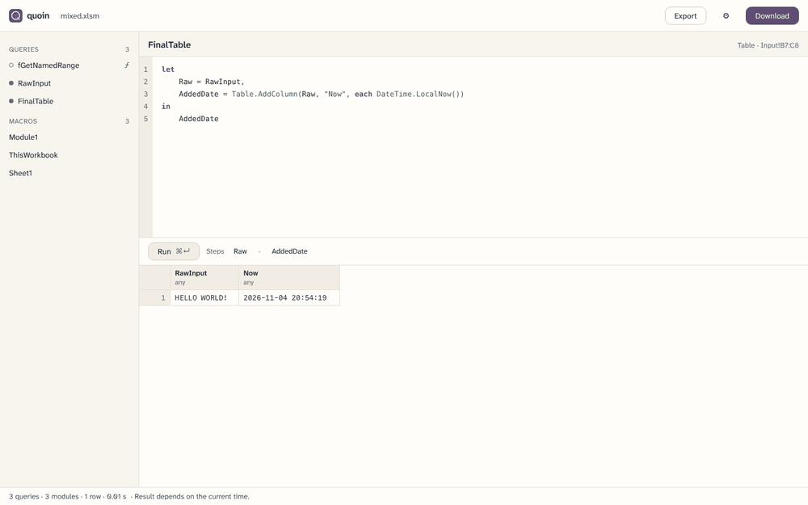
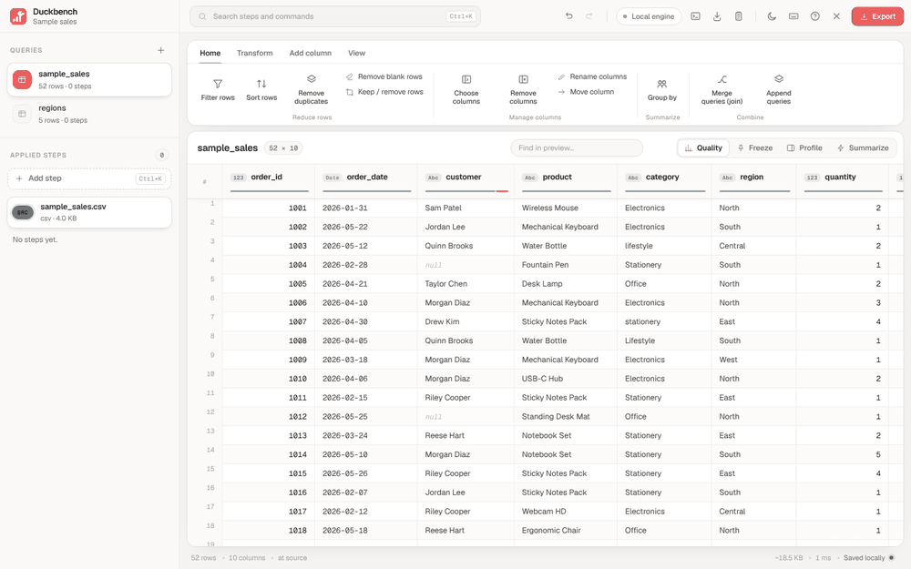
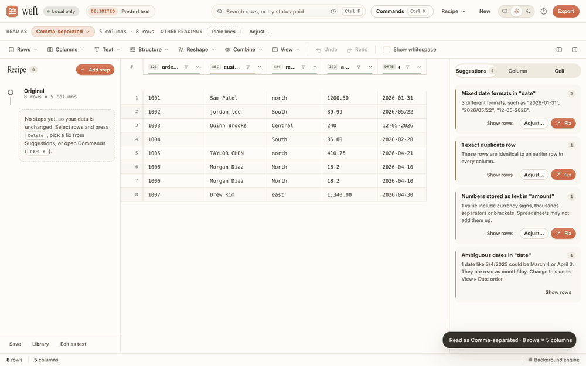
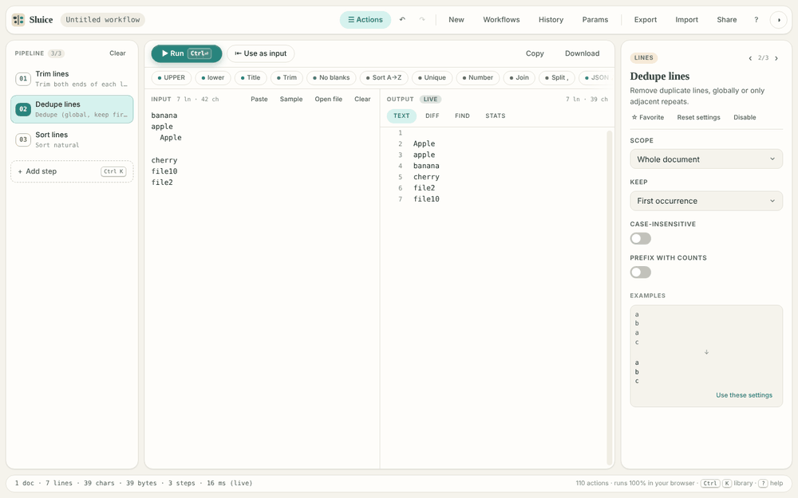

### Ahmed

Local-first tools for working with data.
Spreadsheets, Power Query, CSV and text. They run on your machine and never upload your files.

<table>
<tr>
<td width="50%" valign="top">
 
<b><a href="https://github.com/datakid/power-query-manager">Quoin</a></b> 
Open an Excel workbook in the browser, then edit and run its Power Query and VBA. Includes an M interpreter.
</td>
<td width="50%" valign="top">
 
<b><a href="https://github.com/datakid/duckbench">Duckbench</a></b> 
A data-prep workbench with visual steps and DuckDB SQL. CSV, Excel, JSON and Parquet.
</td>
</tr>
<tr>
<td width="50%" valign="top">
 
<b><a href="https://github.com/datakid/data-cleaner">Weft</a></b> 
Turns pasted text into a clean table. Every change is an undoable step.
</td>
<td width="50%" valign="top">
 
<b><a href="https://github.com/datakid/text-tools">Sluice</a></b> 
Text tools you can chain into pipelines you can run again.
</td>
</tr>
</table>

**Also**

- [Tacit](https://github.com/datakid/tacit): A keyboard-first, offline Android launcher with Arabic-aware search.
- [PS Tools](https://github.com/datakid/ps-tools-): A Windows right-click toolkit. One small exe, no installer.
