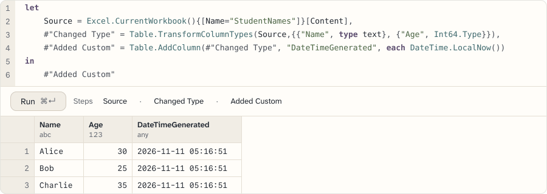
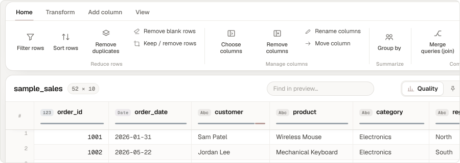
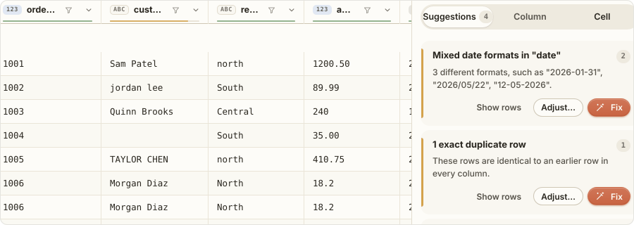

[Featured](#featured) · [How these are built](#how-these-are-built) · [More tools](#more-tools) · [All tools](#all-tools) · [Elsewhere](#elsewhere)

## Featured

### Quoin

<a href="https://power-query-manager.vercel.app"><picture>
<source media="(prefers-color-scheme: dark)" srcset="assets/quoin-dark.svg">

</picture></a>

Runs the Power Query inside an `.xlsx` or `.xlsm` in a browser tab: 511 of 545 library functions are fully supported. VBA is edited, never run.  
`no network` `works offline` `tests in repo` · [Open](https://power-query-manager.vercel.app) · [Source](https://github.com/datakid/power-query-manager)

### Duckbench

<a href="https://duckbench2.vercel.app"><picture>
<source media="(prefers-color-scheme: dark)" srcset="assets/duckbench-dark.svg">

</picture></a>

Cleans, reshapes and joins CSV, Excel, JSON and Parquet files by visual steps or SQL. Files over 1 GiB open in DuckDB, and steps that cannot be translated to SQL then run on the first 1,000,000 rows.  
`CDN on load` `calls extensions.duckdb.org` `tests in repo` · [Open](https://duckbench2.vercel.app) · [Source](https://github.com/datakid/duckbench)

### Weft

<a href="https://data-cleaner-coral.vercel.app"><picture>
<source media="(prefers-color-scheme: dark)" srcset="assets/weft-dark.svg">

</picture></a>

Turns pasted text or a file into a table, one undoable step at a time: 7 kinds of input, from CSV to server logs. When the format guess is wrong, other readings are offered.  
`no network` `tests in repo` · [Open](https://data-cleaner-coral.vercel.app) · [Source](https://github.com/datakid/data-cleaner)

## How these are built

The code in these repositories is written with AI models. Each tool states how far it has been checked: `tests in repo`, `self-test page`, `manual checks` or `unverified`.

Network: `no network` makes no network requests. `CDN on load` loads fonts or libraries from a CDN. `calls <host>` requests that host.  
Offline and platform: `works offline` caches the app with a service worker. `Windows` and `Android` mark apps that are not web pages.  
Checked: `tests in repo` a test command or page exists. `self-test page` the app runs its own checks. `manual checks` is set only by the owner. `unverified` no tests were found.

## More tools

### Data, text and files

**Sluice.** Chains 110 text tools into pipelines that can be saved and re-run. Text only, no binary formats. `no network` `tests in repo` · [Open](https://text-tools-kohl.vercel.app) · [Source](https://github.com/datakid/text-tools)

**Nadir.** Optimisation solver: linear and integer models by simplex and branch and bound, nonlinear ones by ALM with L-BFGS or Differential Evolution. Nonlinear results are not proven global optima. `no network` `works offline` `self-test page` · [Open](https://solver-clone.vercel.app) · [Source](https://github.com/datakid/solver-clone)

**Veritas Lens.** File forensics in the browser, including C2PA manifests. There is no trained classifier, so many generated images without tags report Inconclusive. `CDN on load` `tests in repo` · [Open](https://pattern-recognition-sooty.vercel.app) · [Source](https://github.com/datakid/pattern-recognition-)

### Pharmacy and insurance

**Lx Search.** Formulary lookup over 1,261 medications. The data is a built-in snapshot, and Refresh reads `data/formulary.json`. `CDN on load` `works offline` `tests in repo` · [Open](https://lx-search-kappa.vercel.app) · [Source](https://github.com/datakid/lx-search-)

**Alembic.** Pharmacy dashboard over one fixed Google Sheet, read as CSV. It has no file upload. `calls docs.google.com` `CDN on load` `unverified` · [Open](https://dashboard2-iota.vercel.app) · [Source](https://github.com/datakid/dashboard2)

### Android and Windows

**Tacit.** Keyboard-first Android launcher with Arabic-aware search. Nothing has been measured on a real phone. `Android` `no network` `tests in repo` · [Source](https://github.com/datakid/tacit)

**PS Tools.** Windows right-click toolkit in one exe, with no installer. Administrator actions show their script first and need UAC, and the download-link action fetches the copied address. `Windows` `tests in repo` · [Source](https://github.com/datakid/ps-tools-)

**Contact Flow.** Contact import and export for Android, with search in Arabic, English and Chinese. `.numbers` is exported as a spreadsheet. `Android` `no network` `tests in repo` · [Source](https://github.com/datakid/contact-flow)

## All tools

24 more, by group

### Pharmacy and insurance

| Tool | What it does, and its limit | Checked and network |
| --- | --- | --- |
| [LX Search 5.5](https://github.com/datakid/newlist) | Medicine search with a pricing calculator for several models. The tray holds at most 30 calculations. | `CDN on load` `self-test page` |
| [Lx Search F4](https://github.com/datakid/searchbar) | Lookup over 1,106 medication records in one file. Two Acetyl Salicylic Acid variants still match weakly when spelled phonetically. | `CDN on load` `unverified` |
| [LX Parser](https://github.com/datakid/lx-parser) | Reads messy Arabic and English inventory sheets and detects headers and layout. All data stays in the browser, with no server and no sync. | `calls docs.google.com` `CDN on load` `tests in repo` |
| [Tally](https://github.com/datakid/slippery-form-2.2) | External-tickets report tool with two entry flows, casual and typist. There is no cloud sync or multi-device sharing. | `no network` `works offline` `tests in repo` |
| [Daftar](https://github.com/datakid/daftar) | Ledger reports from dispensing sheets in Excel or CSV, printed onto A4 forms. Inline cell editing is not built. | `no network` `self-test page` |
| [Monthly drug-group statement](https://github.com/datakid/finalapp) | Monthly drug-group totals by category, with bulk file upload. Submission uses `no-cors`, so receipt is never confirmed. | `calls workers.dev` `CDN on load` `tests in repo` |
| [Dashboard Arena](https://github.com/datakid/dashboard-yearly) | Superseded by Alembic. Reads one fixed Google Sheet as CSV. | `calls docs.google.com` `CDN on load` `unverified` |
| [Drug protocols](https://github.com/datakid/experimental) | 59 drug entries with search. The page states that its content is AI-generated and not for actual use. | `CDN on load` `unverified` |

### Data and files

| Tool | What it does, and its limit | Checked and network |
| --- | --- | --- |
| [Floe](https://github.com/datakid/polars-desktop-demo) | Data preparation for web and desktop, with Parquet read by row group. The native Rust command line is not built; the `floe` CLI runs on the JS engine. | `no network` `works offline` `tests in repo` |
| [bugvert](https://github.com/datakid/bugvert) | Unit and price converter for messy pharmacy and inventory sheets. Choosing which sheets to merge is not built. | `CDN on load` `unverified` |
| [Draw](https://github.com/datakid/draw) | Charts from a CSV, XLSX, Parquet or JSON file. Column names cannot contain `[` or `]`. | `CDN on load` `unverified` |
| [Rubric](https://github.com/datakid/ranking-builder-demo) | Weighted ranking workbench with 12 value functions and 4 weighting methods. It ranks from the criteria and weights entered and shows how close the ranking is to flipping. | `no network` `unverified` |
| [Harvest Studio](https://github.com/datakid/harvest-studio) | Harvests favicons, traces glyphs and exports icon sets for LinkExpress. Blocked pages are reported as blocked and not converted. | `calls its fetch proxy` `tests in repo` |
| [Duckbench for Windows](https://github.com/datakid/duckbench-tauri-demo) | Duckbench on Tauri 2 and DuckDB. The release workflow does not sign installers or publish `latest.json`. | `Windows` `unverified` |

### Launchers and workspace

| Tool | What it does, and its limit | Checked and network |
| --- | --- | --- |
| [LinkExpress](https://github.com/datakid/app-launcher) | Bilingual launchpad driven by `links.json`. Icons that are not bundled are fetched from jsDelivr. | `calls cdn.jsdelivr.net` `works offline` `unverified` |
| [Fihrist](https://github.com/datakid/alt-app-lanucher) | Keyboard-first index of the tools above. It lists only the tools in `fihrist.json`. | `CDN on load` `works offline` `tests in repo` |
| [Lx Workspace](https://github.com/datakid/Desktop) | Window manager, command palette and dock for 7 tools. The tool list is fixed in `index.html`. | `calls each tool's site` `works offline` `unverified` |

### Utilities and reference

| Tool | What it does, and its limit | Checked and network |
| --- | --- | --- |
| [Raqam](https://github.com/datakid/lx-id) | Egyptian national ID, retirement and date toolkit. The check digit algorithm is not public, so the checksum shown is a heuristic. | `CDN on load` `works offline` `tests in repo` |
| [gitlink](https://github.com/datakid/gitlink) | Maps a GitHub account's follow graph: mutuals, followers, following, fans. Hidden or suspended accounts can leave lists shorter than the profile counts. | `calls api.github.com` `tests in repo` |
| [Survival Mirror](https://github.com/datakid/survival-mirror) | Population survival curves from age, sex, country and lifestyle answers. Death rates are held at today's values. | `no network` `unverified` |
| [Pillbug](https://github.com/datakid/Pillbug) | Pharmacy inventory demo with no backend. Data lives in `localStorage` in one browser. | `CDN on load` `tests in repo` |
| [Qisma](https://github.com/datakid/shareholders) | Fair distribution of incentive pools to the piastre, in Arabic. Review rows are built eagerly, so the first render at 1M+ rows allocates a row object per row. | `CDN on load` `works offline` `self-test page` |
| [Pandas and Polars tutorial](https://github.com/datakid/pandas-polars-basic-tutorial) | 21 sections of paired code for Pandas 3.0 and Polars 1.42. The code is shown, not run. | `CDN on load` `unverified` |
| [Contact Flow Web](https://github.com/datakid/contact-flow-web) | Contact manager in the browser: SQLite on the Origin Private File System, export in 5 formats, Arabic and Chinese search. There is no sync, and clearing site data deletes the contacts. | `no network` `works offline` `tests in repo` |

## Elsewhere

More tools are on the alternate account, [nickburser122](https://github.com/nickburser122). Forks in this account (tacit, roi-calculator, entity-tracker, To-Do) come from that account. winget-pkgs is an upstream fork.
